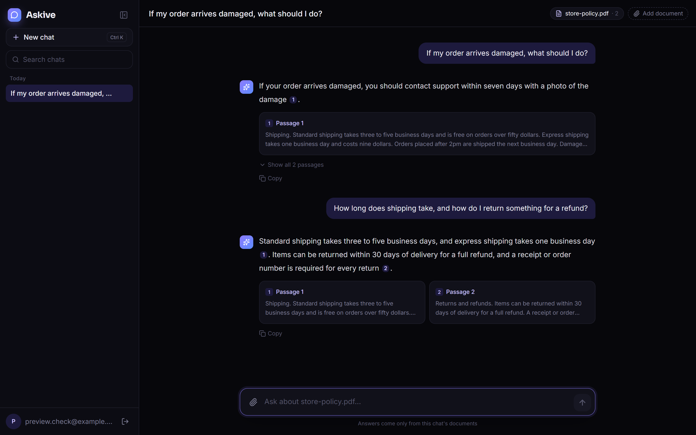
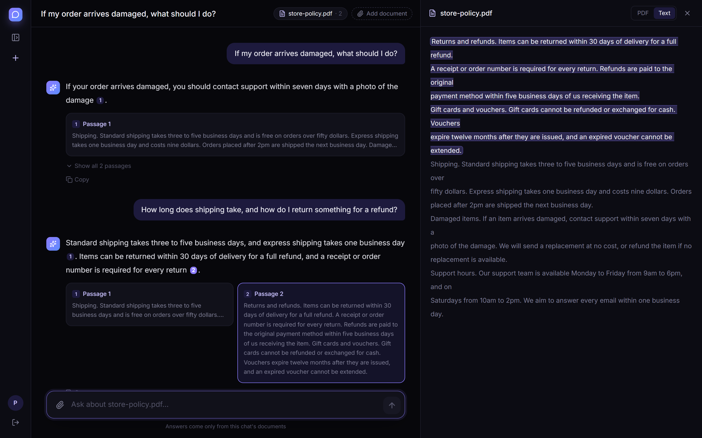
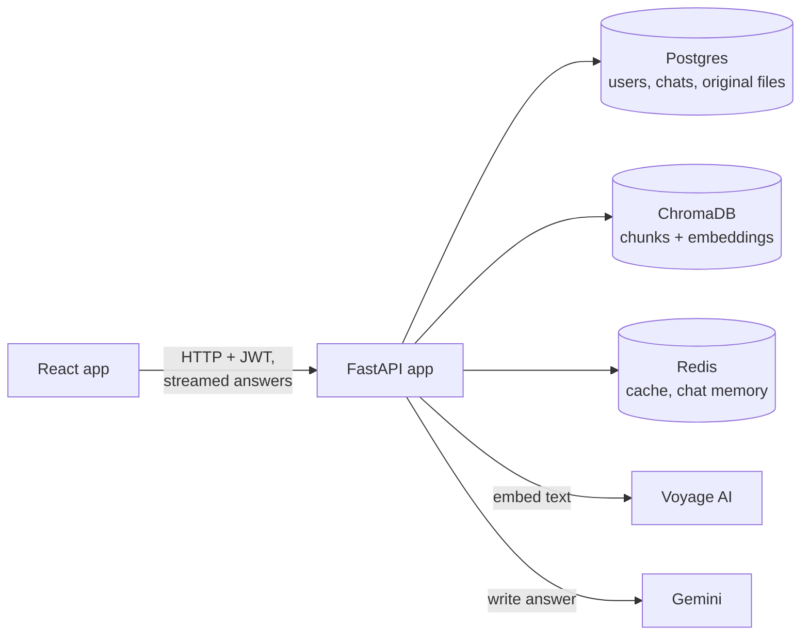

# Askive

Chat with your documents. Upload a PDF, Word or text file, ask questions
in plain language, and get answers that cite the exact passages they came
from. Click a citation and the document opens beside the chat with that
passage highlighted.

Askive is a retrieval-augmented generation (RAG) app: instead of letting
the language model answer from memory, it first finds the most relevant
passages in your documents and has the model answer from those alone.





## Features

- **React interface.** A dark, single-page app built with React,
  TypeScript, Vite and Tailwind CSS. Chats live in a sidebar grouped by
  date, with search, rename and delete. Drop a file anywhere to upload it.
  Ctrl+K starts a new chat.
- **Streaming answers.** Answers appear word by word over Server-Sent
  Events. The matching passages are sent first, so the page shows what was
  found while the model is still writing.
- **Citations and document preview.** Every claim is tagged with the passage
  it came from, like [2]. Only the cited passages are shown (the rest are one
  click away). Clicking a citation opens the original PDF, or its text with
  the passage highlighted, in a side panel. The sidebar folds into an icon
  rail while the panel is open.
- **Chats saved on the server.** Conversations, their documents and every
  answer with its sources are stored in the database, so they follow you
  to any device.
- **Hybrid search.** Combines meaning-based search (embeddings) with
  keyword search (BM25), merged with Reciprocal Rank Fusion, so both
  paraphrased questions and exact terms like names or error codes are found.
- **Semantic chunking.** Documents are split where the topic changes,
  into paragraph-sized pieces (400 to 1,500 characters), not every N
  characters.
- **Conversation memory.** Follow-up questions ("what about digital
  products?") are understood in the context of the chat.
- **Accounts.** Email and password sign-in with JWT tokens. Each user only
  ever searches their own documents, and each chat only its own uploads.
- **Caching.** Repeated questions are answered from Redis in milliseconds,
  without calling the embedding or language model again.
- **Production-style deployment.** Docker image, docker-compose for local
  use, and Kubernetes manifests with health probes, persistent storage and
  autoscaling.
- **Tested and load-tested.** 105 backend tests run in CI against both
  SQLite and Postgres, 25 frontend tests check the interface, and a Locust
  load test measures capacity (results below).

## How it works



**Uploading a document**

1. The text is extracted from the PDF, Word or text file, and the original
   file is kept in the database for the preview (up to 10 MB).
2. Every sentence is embedded with Voyage AI; a new chunk starts wherever
   the meaning shifts between neighbouring sentences, as long as the
   current chunk has reached 400 characters, and always before it passes
   1,500.
3. The chunks are embedded and stored in ChromaDB, tagged with the owner's
   user ID and the document's ID. Long documents are sent to Voyage in
   batches.

**Asking a question**

1. If the same question was asked before in the same context, the cached
   answer is returned straight from Redis.
2. Otherwise the question (plus the previous one, for follow-ups) is
   embedded, and the chat's documents are searched two ways: by meaning in
   ChromaDB and by keywords with BM25. The two rankings are fused into the
   top 5 chunks.
3. The passages are numbered and streamed to the browser straight away.
4. Gemini writes the answer using only those passages and the recent
   conversation, citing them by number. Its words are streamed to the
   browser as they arrive; when it finishes, the answer and its sources are
   saved to the chat and cached.

## Tech stack

| Area | Tools |
| --- | --- |
| Frontend | React 19, TypeScript, Vite, Tailwind CSS 4, TanStack Query, React Router, react-markdown |
| Backend | Python 3.13, FastAPI, Pydantic, Server-Sent Events |
| AI | Voyage AI (`voyage-3` embeddings), Google Gemini |
| Search | ChromaDB (vector search), hand-written BM25, Reciprocal Rank Fusion |
| Data | Postgres via SQLAlchemy (SQLite for local dev), Redis |
| Auth | bcrypt password hashing, JWT (PyJWT) |
| Infrastructure | Docker (multi-stage build), docker-compose, Kubernetes (minikube) |
| Quality | pytest, Vitest, React Testing Library, oxlint, GitHub Actions, Locust |

## Getting started

You need API keys for [Voyage AI](https://www.voyageai.com) and
[Google Gemini](https://ai.google.dev). Copy the example settings and fill
them in:

```bash
cp .env.example .env
```

Set `GEMINI_API_KEY`, `VOYAGE_API_KEY` and a `JWT_SECRET`, which you can
generate with:

```bash
python -c "import secrets; print(secrets.token_urlsafe(32))"
```

### Option 1: run locally

Uses a local SQLite file and an in-process cache; no other services needed.
You also need a current [Node.js](https://nodejs.org) to build the
interface (CI uses Node 26).

```bash
python -m venv venv
source venv/bin/activate        # Windows: venv\Scripts\activate
pip install -r requirements.txt

cd frontend && npm ci && npm run build && cd ..
uvicorn app.main:app --reload
```

Open http://localhost:8000. FastAPI serves the built interface from
`frontend/dist`.

To work on the interface with instant reloads, keep uvicorn running and
start Vite's dev server in a second terminal:

```bash
cd frontend && npm run dev
```

Then open http://localhost:5173. API calls are forwarded to port 8000, so
no CORS setup is needed.

### Option 2: run with Docker

```bash
docker compose up -d --build
```

This starts four containers: the API on http://localhost:8000, Postgres,
ChromaDB and Redis. The image is built in two stages: a Node stage builds
the React interface, and only the finished files are copied into the
Python image. The API container stores nothing itself; the other
three keep their data in named volumes, so it survives
`docker compose down` and rebuilds (`docker compose down -v` deletes it).
API keys are passed in from `.env` at runtime and are never copied into
the image.

### Option 3: run on Kubernetes (minikube)

The manifests in `k8s/` define a namespace, a ConfigMap for settings,
Postgres as a StatefulSet, ChromaDB and Redis as Deployments with
persistent volumes, the stateless API as a Deployment behind a Service, and
an optional HorizontalPodAutoscaler.

```bash
minikube start --driver=docker --memory=2500 --cpus=2
docker compose build api
minikube image load askive-api:latest

kubectl apply -f k8s/namespace.yaml
# Secrets are created from your own values, never from a file in git:
kubectl create secret generic askive-secrets -n askive \
  --from-literal=GEMINI_API_KEY=... \
  --from-literal=VOYAGE_API_KEY=... \
  --from-literal=JWT_SECRET=... \
  --from-literal=POSTGRES_PASSWORD=<random> \
  --from-literal=DATABASE_URL=postgresql+psycopg://askive:<random>@postgres:5432/askive
kubectl apply -k k8s/

kubectl get pods -n askive          # wait until all 4 pods are READY 1/1
minikube service api -n askive      # opens Askive in the browser
```

To turn on autoscaling (1 to 3 API pods at 70% CPU):

```bash
minikube addons enable metrics-server
kubectl apply -f k8s/hpa.yaml
kubectl get hpa -n askive --watch
```

Autoscaling works because no state lives inside an API pod: users are in
Postgres, chunks in ChromaDB, and the cache and chat memory in Redis.

Each way of running Askive has its own database, so an account created in
one doesn't exist in another.

## Configuration

All settings are environment variables; `.env.example` lists the ones you'll
usually need.

| Variable | Default | Purpose |
| --- | --- | --- |
| `GEMINI_API_KEY` | (required) | Google Gemini API key |
| `VOYAGE_API_KEY` | (required) | Voyage AI API key |
| `JWT_SECRET` | random per start | Signs login tokens; set it, or every restart logs everyone out |
| `JWT_EXPIRE_MINUTES` | `1440` | How long a login lasts |
| `DATABASE_URL` | (unset) | Postgres connection URL; unset uses SQLite at `DATABASE_PATH` |
| `DATABASE_PATH` | `./data/askive.db` | SQLite file for local development |
| `REDIS_URL` | (unset) | Redis for cache and chat memory; unset uses an in-process store |
| `CACHE_TTL_SECONDS` | `3600` | How long cached answers are kept |
| `CHROMA_HOST`, `CHROMA_PORT` | (unset), `8000` | ChromaDB server; unset embeds ChromaDB at `CHROMA_DB_PATH` |
| `CHROMA_DB_PATH` | `./data/chroma_db` | Local ChromaDB storage |
| `EMBEDDING_MODEL` | `voyage-3` | Voyage embedding model |
| `MAX_UPLOAD_MB` | `10` | Largest file you can upload |
| `FRONTEND_DIST` | `./frontend/dist` | The built React interface |
| `THREAD_POOL_SIZE` | `100` | Requests a pod can process at once |
| `FAKE_AI` | (unset) | Load testing only: `1` replaces Voyage and Gemini with timed stand-ins |

## API

Interactive documentation is served at `/docs` while the app runs.

| Method and path | Description |
| --- | --- |
| `POST /auth/register` | Create an account (JSON: `email`, `password`) |
| `POST /auth/login` | Sign in (form fields: `username` = email, `password`); returns a JWT |
| `GET /auth/me` | The signed-in user |
| `GET /chats`, `POST /chats` | List your chats, or start a new one |
| `GET`, `PATCH`, `DELETE /chats/{id}` | A chat with its documents and messages; rename; delete |
| `POST /chats/{id}/documents` | Upload a PDF, Word or text file into a chat |
| `POST /chats/{id}/messages/stream` | Ask a question; the answer is streamed as Server-Sent Events (`sources`, `delta`, `done`, `error`) |
| `POST /chats/{id}/messages` | The same question, answered in one response |
| `GET /documents/` | The signed-in user's documents |
| `GET /documents/{id}/file` | The original file, for the preview |
| `GET /documents/{id}/text` | The extracted text, for the text view |
| `POST /upload/`, `POST /chat/` | The v2 endpoints, kept for API clients: upload, then ask about the given `document_ids` |
| `GET /health` | Readiness: ChromaDB, Redis and the database are reachable (503 otherwise) |
| `GET /health/live` | Liveness: the process is running |

Every route except registration, login and health checks requires an
`Authorization: Bearer <token>` header.

## Security

- Passwords are stored only as bcrypt hashes, and emails are stored in
  lower case so sign-in ignores capitalisation.
- Every chunk is tagged with its owner, and both searches filter on it, so
  one user can never retrieve another user's documents, even by sending
  their document IDs. Chats and original files are checked the same way;
  someone else's chat looks exactly like one that doesn't exist (404).
- Answers are rendered with react-markdown, which never inserts raw HTML,
  since answers can quote uploaded documents.
- Original files are shown in the browser only if they are PDF, Word or
  plain text; anything else is sent as a download, with `nosniff` so the
  browser can't be tricked into running it as a page.
- API keys and passwords are read from the environment; they never appear
  in the code, the Docker image or the Kubernetes manifests.

## Tests

```bash
pip install -r requirements-dev.txt
pytest
```

Voyage and Gemini are replaced with offline fakes in `tests/conftest.py`, so
the tests need no API keys. The fake Gemini also streams, and fails the
test if the app keeps reading after the answer is complete.

The interface has its own tests (Vitest and React Testing Library, in a
simulated browser, with the backend faked):

```bash
cd frontend
npm test            # or: npm run test:watch
```

They cover parsing the streamed answer (including events split across
network packets), turning `[2]` into citations, showing only cited
passages, finding a passage inside the document text, the question box,
and signing in and out.

GitHub Actions runs on every pull request: the backend suite twice (on
SQLite and against a real Postgres service), and the frontend's lint, tests
and type-checked build.

## Load test

**One API pod handles 50 simultaneous heavy users with 0 errors (p95 5.0 s
for a new question, 4.7 s of which is the language model); with autoscaling
to 3 pods, 100 users run at 0.1% errors instead of 11.7%.** Measured with
Locust on minikube (2 CPUs), with the AI services replaced by timed
stand-ins so no API quota is spent.

| Simultaneous users | 1 API pod: errors | 1 pod: new question p95 | Autoscaled (3 pods): errors | 3 pods: new question p95 |
| --- | --- | --- | --- | --- |
| 10 | 0% | 4.9 s | 0% | 4.8 s |
| 25 | 0% | 4.8 s | 0% | 6.2 s |
| 50 | 0% | 5.0 s | 0% | 5.5 s |
| 100 | 11.7% (pod restarted) | 29 s | 0.1% | 18 s |

Cached answers return in about 11 ms. The test found and fixed three
bottlenecks: a keyword index that was rebuilt (8.8 s) after every upload, a
liveness probe that restarted busy pods, and a worker thread pool too small
for long language-model calls.

Full method, every run and how to repeat it: [loadtest/README.md](loadtest/README.md).

## Project structure

```
frontend/              the React interface
  src/
    App.tsx            routes, sign-in gate, sidebar layout
    auth.tsx           signed-in user and token
    lib/api.ts         API client
    lib/stream.ts      reads the streamed answer (Server-Sent Events)
    pages/             sign-in page, chat page
    components/        sidebar, answer with citations, document preview, question box
    *.test.ts(x)       tests, next to the code they test
app/
  main.py              FastAPI app, routers, serves the built interface
  config.py            settings from environment variables
  auth.py              JWT creation and checking
  db.py                SQLAlchemy tables (Postgres or SQLite)
  routes/              auth, chats, upload, documents, chat, health
  services/
    qa.py              search, prompt and Gemini call, plain or streamed
    chats.py           saved chats and messages
    ingest.py          upload pipeline: extract, chunk, embed, store
    chunking.py        semantic chunking
    embeddings.py      Voyage AI client, batching, retries
    retrieval.py       ChromaDB storage, BM25, hybrid search
    answer_cache.py    cached answers and invalidation
    cache.py           Redis or in-process key-value store
    memory.py          conversation memory
    users.py           accounts and document ownership
    fake_ai.py         timed stand-ins for load testing
docs/screenshots/      images used in this README
k8s/                   Kubernetes manifests
loadtest/              Locust load test and results
tests/                 pytest suite
Dockerfile
docker-compose.yml
```

## About

Built by Ankita Gaikwad. Versions 2 and 3 were developed with the help of
Claude Code, an AI coding assistant.
