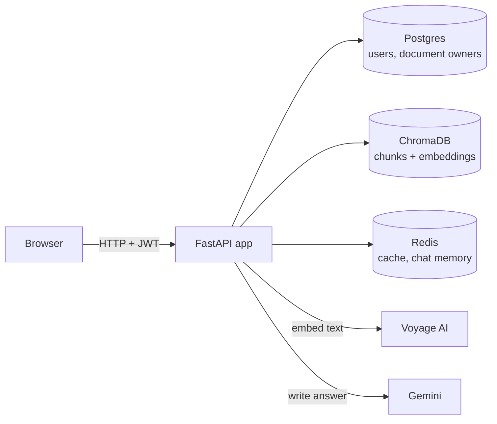

# Askive

Chat with your documents. Upload a PDF, Word or text file, ask questions
in plain language, and get answers grounded in the document, with the
source passages shown alongside.

Askive is a retrieval-augmented generation (RAG) app: instead of letting
the language model answer from memory, it first finds the most relevant
passages in your documents and has the model answer from those alone.


## Features

- **Hybrid search.** Combines meaning-based search (embeddings) with
  keyword search (BM25), merged with Reciprocal Rank Fusion, so both
  paraphrased questions and exact terms like names or error codes are found.
- **Semantic chunking.** Documents are split where the topic changes, not
  every N characters.
- **Conversation memory.** Follow-up questions ("what about digital
  products?") are understood in the context of the chat.
- **Accounts.** Email and password sign-in with JWT tokens. Each user only
  ever searches their own documents, and each chat only its own uploads.
- **Caching.** Repeated questions are answered from Redis in milliseconds,
  without calling the embedding or language model again.
- **Production-style deployment.** Docker image, docker-compose for local
  use, and Kubernetes manifests with health probes, persistent storage and
  autoscaling.
- **Tested and load-tested.** 70 automated tests run in CI against both
  SQLite and Postgres, and a Locust load test measures capacity (results
  below).

## How it works



**Uploading a document**

1. The text is extracted from the PDF, Word or text file.
2. Every sentence is embedded with Voyage AI; a new chunk starts wherever
   the meaning shifts between neighbouring sentences.
3. The chunks are embedded and stored in ChromaDB, tagged with the owner's
   user ID. Long documents are sent to Voyage in batches.

**Asking a question**

1. If the same question was asked before in the same context, the cached
   answer is returned straight from Redis.
2. Otherwise the question (plus the previous one, for follow-ups) is
   embedded, and the chat's documents are searched two ways: by meaning in
   ChromaDB and by keywords with BM25. The two rankings are fused into the
   top 5 chunks.
3. Gemini writes the answer using only those chunks and the recent
   conversation. The answer is cached and shown with its sources.

## Tech stack

| Area | Tools |
| --- | --- |
| Backend | Python 3.13, FastAPI, Pydantic |
| AI | Voyage AI (`voyage-3` embeddings), Google Gemini |
| Search | ChromaDB (vector search), hand-written BM25, Reciprocal Rank Fusion |
| Data | Postgres via SQLAlchemy (SQLite for local dev), Redis |
| Auth | bcrypt password hashing, JWT (PyJWT) |
| Frontend | Plain HTML, CSS and JavaScript; marked + DOMPurify for answers |
| Infrastructure | Docker, docker-compose, Kubernetes (minikube) |
| Quality | pytest, GitHub Actions, Locust |

## Getting started

You need API keys for [Voyage AI](https://www.voyageai.com) and
[Google Gemini](https://ai.google.dev). Copy the example settings and fill
them in:

```bash
cp .env.example .env
```

Set `GEMINI_API_KEY`, `VOYAGE_API_KEY` and a `JWT_SECRET`, which you can
generate with:

```bash
python -c "import secrets; print(secrets.token_urlsafe(32))"
```

### Option 1: run locally

Uses a local SQLite file and an in-process cache; no other services needed.

```bash
python -m venv venv
source venv/bin/activate        # Windows: venv\Scripts\activate
pip install -r requirements.txt
uvicorn app.main:app --reload
```

Open http://localhost:8000.

### Option 2: run with Docker

```bash
docker compose up -d --build
```

This starts four containers: the API on http://localhost:8000, Postgres,
ChromaDB and Redis. The API container stores nothing itself; the other
three keep their data in named volumes, so it survives
`docker compose down` and rebuilds (`docker compose down -v` deletes it).
API keys are passed in from `.env` at runtime and are never copied into
the image.

### Option 3: run on Kubernetes (minikube)

The manifests in `k8s/` define a namespace, a ConfigMap for settings,
Postgres as a StatefulSet, ChromaDB and Redis as Deployments with
persistent volumes, the stateless API as a Deployment behind a Service, and
an optional HorizontalPodAutoscaler.

```bash
minikube start --driver=docker --memory=2500 --cpus=2
docker compose build api
minikube image load askive-api:latest

kubectl apply -f k8s/namespace.yaml
# Secrets are created from your own values, never from a file in git:
kubectl create secret generic askive-secrets -n askive \
  --from-literal=GEMINI_API_KEY=... \
  --from-literal=VOYAGE_API_KEY=... \
  --from-literal=JWT_SECRET=... \
  --from-literal=POSTGRES_PASSWORD=<random> \
  --from-literal=DATABASE_URL=postgresql+psycopg://askive:<random>@postgres:5432/askive
kubectl apply -k k8s/

kubectl get pods -n askive          # wait until all 4 pods are READY 1/1
minikube service api -n askive      # opens Askive in the browser
```

To turn on autoscaling (1 to 3 API pods at 70% CPU):

```bash
minikube addons enable metrics-server
kubectl apply -f k8s/hpa.yaml
kubectl get hpa -n askive --watch
```

Autoscaling works because no state lives inside an API pod: users are in
Postgres, chunks in ChromaDB, and the cache and chat memory in Redis.

Each way of running Askive has its own database, so an account created in
one doesn't exist in another.

## Configuration

All settings are environment variables; `.env.example` lists the ones you'll
usually need.

| Variable | Default | Purpose |
| --- | --- | --- |
| `GEMINI_API_KEY` | (required) | Google Gemini API key |
| `VOYAGE_API_KEY` | (required) | Voyage AI API key |
| `JWT_SECRET` | random per start | Signs login tokens; set it, or every restart logs everyone out |
| `JWT_EXPIRE_MINUTES` | `1440` | How long a login lasts |
| `DATABASE_URL` | (unset) | Postgres connection URL; unset uses SQLite at `DATABASE_PATH` |
| `DATABASE_PATH` | `./data/askive.db` | SQLite file for local development |
| `REDIS_URL` | (unset) | Redis for cache and chat memory; unset uses an in-process store |
| `CACHE_TTL_SECONDS` | `3600` | How long cached answers are kept |
| `CHROMA_HOST`, `CHROMA_PORT` | (unset), `8000` | ChromaDB server; unset embeds ChromaDB at `CHROMA_DB_PATH` |
| `CHROMA_DB_PATH` | `./data/chroma_db` | Local ChromaDB storage |
| `EMBEDDING_MODEL` | `voyage-3` | Voyage embedding model |
| `THREAD_POOL_SIZE` | `100` | Requests a pod can process at once |
| `FAKE_AI` | (unset) | Load testing only: `1` replaces Voyage and Gemini with timed stand-ins |

## API

Interactive documentation is served at `/docs` while the app runs.

| Method and path | Description |
| --- | --- |
| `POST /auth/register` | Create an account (JSON: `email`, `password`) |
| `POST /auth/login` | Sign in (form fields: `username` = email, `password`); returns a JWT |
| `GET /auth/me` | The signed-in user |
| `POST /upload/` | Upload a PDF, Word or text file |
| `GET /documents/` | The signed-in user's documents |
| `POST /chat/` | Ask a question about the given `document_ids` |
| `GET /health` | Readiness: ChromaDB, Redis and the database are reachable (503 otherwise) |
| `GET /health/live` | Liveness: the process is running |

Every route except registration, login and health checks requires an
`Authorization: Bearer <token>` header.

## Security

- Passwords are stored only as bcrypt hashes, and emails are stored in
  lower case so sign-in ignores capitalisation.
- Every chunk is tagged with its owner, and both searches filter on it, so
  one user can never retrieve another user's documents, even by sending
  their document IDs.
- Answers are rendered from Markdown and sanitised with DOMPurify before
  display, since they can quote uploaded documents.
- API keys and passwords are read from the environment; they never appear
  in the code, the Docker image or the Kubernetes manifests.

## Tests

```bash
pip install -r requirements-dev.txt
pytest
```

Voyage and Gemini are replaced with offline fakes in `tests/conftest.py`, so
the tests need no API keys. GitHub Actions runs the suite twice on every
pull request: once on SQLite and once against a real Postgres service.

## Load test

**One API pod handles 50 simultaneous heavy users with 0 errors (p95 5.0 s
for a new question, 4.7 s of which is the language model); with autoscaling
to 3 pods, 100 users run at 0.1% errors instead of 11.7%.** Measured with
Locust on minikube (2 CPUs), with the AI services replaced by timed
stand-ins so no API quota is spent.

| Simultaneous users | 1 API pod: errors | 1 pod: new question p95 | Autoscaled (3 pods): errors | 3 pods: new question p95 |
| --- | --- | --- | --- | --- |
| 10 | 0% | 4.9 s | 0% | 4.8 s |
| 25 | 0% | 4.8 s | 0% | 6.2 s |
| 50 | 0% | 5.0 s | 0% | 5.5 s |
| 100 | 11.7% (pod restarted) | 29 s | 0.1% | 18 s |

Cached answers return in about 11 ms. The test found and fixed three
bottlenecks: a keyword index that was rebuilt (8.8 s) after every upload, a
liveness probe that restarted busy pods, and a worker thread pool too small
for long language-model calls.

Full method, every run and how to repeat it: [loadtest/README.md](loadtest/README.md).

## Project structure

```
app/
  main.py              FastAPI app, routers, startup
  config.py            settings from environment variables
  auth.py              JWT creation and checking
  db.py                SQLAlchemy tables (Postgres or SQLite)
  routes/              auth, upload, documents, chat, health
  services/
    chunking.py        semantic chunking
    embeddings.py      Voyage AI client, batching, retries
    retrieval.py       ChromaDB storage, BM25, hybrid search
    answer_cache.py    cached answers and invalidation
    cache.py           Redis or in-process key-value store
    memory.py          conversation memory
    users.py           accounts and document ownership
    fake_ai.py         timed stand-ins for load testing
  static/              the web interface
k8s/                   Kubernetes manifests
loadtest/              Locust load test and results
tests/                 pytest suite
Dockerfile
docker-compose.yml
```

## Roadmap

- [x] v1: semantic chunking, embeddings, vector search, conversation memory
- [x] v2: tests and CI, hybrid search, accounts, caching, Docker,
      Kubernetes with autoscaling, Postgres, load testing
- [ ] Build and publish the Docker image from CI
- [ ] Fully async calls to the AI services, removing the per-pod thread limit
- [ ] Store embeddings in Postgres with pgvector, replacing ChromaDB
- [ ] Email verification and password reset

## About

Built by Ankita Gaikwad. Version 2 was developed with the help of Claude
Code, an AI coding assistant.
